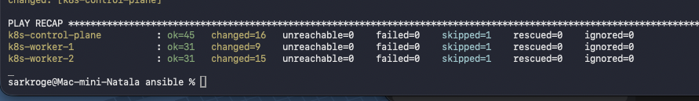
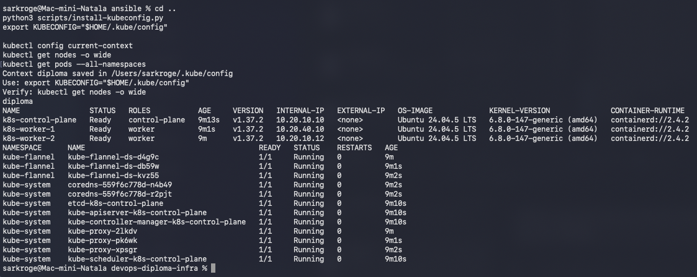
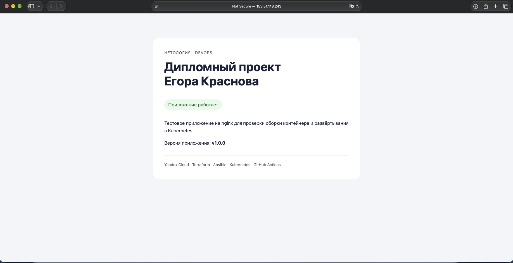
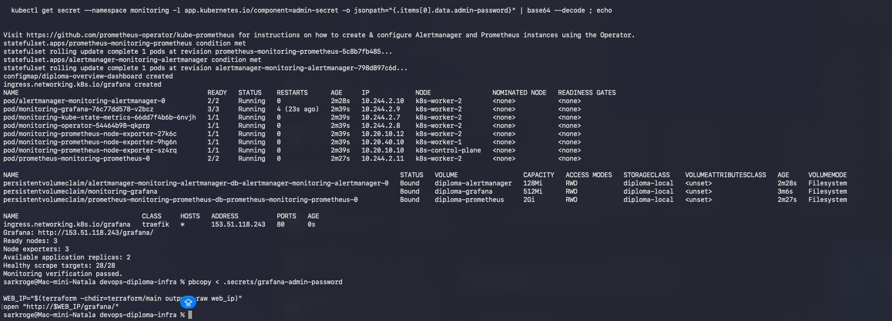
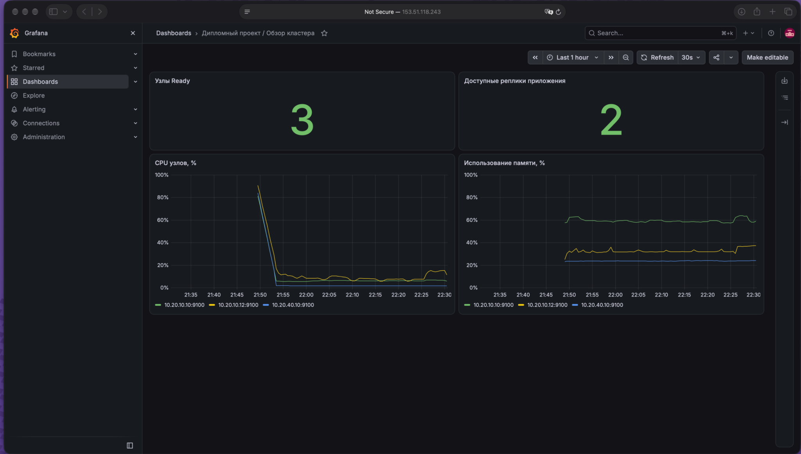
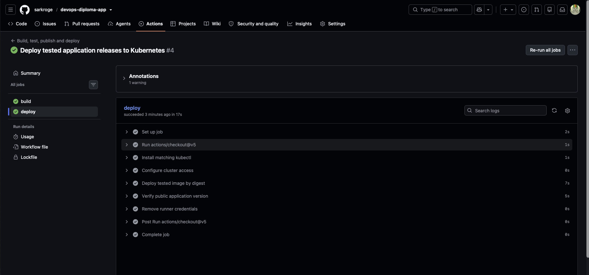
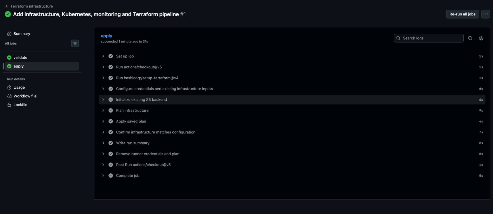
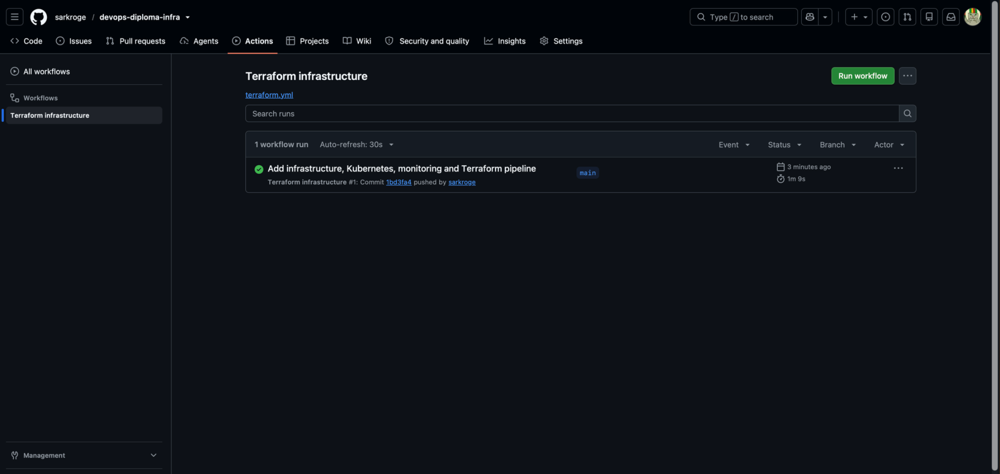

# Дипломный практикум DevOps в Yandex Cloud

Здравствуйте! Представляю дипломный проект. В работе использован вариант
самостоятельной установки Kubernetes на виртуальные машины Yandex Cloud.
Инфраструктура описана в Terraform, кластер устанавливается Ansible,
приложение и мониторинг развёрнуты в Kubernetes. Для автоматизации выбран GitHub Actions.

Автор: **Краснов Егор**. Проверки и скриншоты выполнены **1 ноября 2026 года**.

## Ссылки для проверки

| Материал | Ссылка |
| --- | --- |
| Инфраструктура, Ansible, Kubernetes, мониторинг | [devops-diploma-infra](https://github.com/sarkroge/devops-diploma-infra) |
| Приложение и Dockerfile | [devops-diploma-app](https://github.com/sarkroge/devops-diploma-app) |
| Terraform pipeline | [Actions инфраструктуры](https://github.com/sarkroge/devops-diploma-infra/actions/workflows/terraform.yml) |
| Сборка и деплой приложения | [Actions приложения](https://github.com/sarkroge/devops-diploma-app/actions/workflows/build.yml) |
| Тестовое приложение, HTTP/80 | [http://153.51.118.243/](http://153.51.118.243/) |
| Версия приложения | [version.json](http://153.51.118.243/version.json) |
| Grafana, HTTP/80 | [http://153.51.118.243/grafana/](http://153.51.118.243/grafana/) |

Grafana: пользователь **admin**, пароль передаю отдельно в закрытом поле сдачи.
Дашборд: **«Дипломный проект / Обзор кластера»**.

Образ приложения: `cr.yandex/crpi32ickihldl29g1fg/diploma-app:v1.0.1`.
Реестр приватный. После авторизации с правами pull образ можно получить командой:

```bash
docker pull cr.yandex/crpi32ickihldl29g1fg/diploma-app:v1.0.1
```

## Соответствие заданию

| Требование | Реализация и подтверждение |
| --- | --- |
| Terraform и сервисный аккаунт | [Bootstrap](terraform/bootstrap) создаёт аккаунты, бакет и назначения ролей; [основная конфигурация](terraform/main) создаёт ресурсы стенда |
| Внешнее хранение state | Закрытый версионируемый S3-бакет; успешное подключение к тому же backend в GitHub Actions |
| VPC и подсети в разных зонах | Одна VPC, подсети в `ru-central1-a`, `ru-central1-d`, `ru-central1-e` |
| Самостоятельный Kubernetes | Три ВМ; [Ansible](ansible) устанавливает containerd, kubeadm и Flannel; три узла Ready |
| Приложение и собственный Dockerfile | Nginx со статической страницей, health endpoint и версией; образ опубликован в Yandex Container Registry |
| Мониторинг | kube-prometheus-stack: Prometheus, Grafana, Alertmanager, node-exporter, kube-state-metrics; дашборд с данными |
| HTTP-доступ | Приложение `/` и Grafana `/grafana/` доступны через Traefik на порту 80 |
| Terraform pipeline | Push в main автоматически запускает validate, plan, apply сохранённого плана и повторный plan |
| CI приложения | Push запускает сборку, тестирование nginx/HTTP и публикацию образа; для pull request публикация отключена |
| CD по тегу | Для `v1.0.1` успешно выполнены build и deploy, проверена публичная версия |
| Репозитории на одном ресурсе | Оба репозитория размещены на GitHub |

## 1. Облачная инфраструктура

Начальная конфигурация `terraform/bootstrap` отделена от `terraform/main`.
Bootstrap state хранится локально; основной state сохраняется в бакете
`sarkroge-diploma-state-b1g90k05go90aj6v84m2`,
объект `diploma/main/terraform.tfstate`.

Terraform использует отдельный сервисный аккаунт. Его роли ограничены сервисами
Compute, VPC и Container Registry в каталоге и доступом к бакету state.
Широкие роли администратора всего облака не используются. Статические S3-ключи,
авторизованные JSON-ключи, state и приватный SSH-ключ исключены из Git.

| Узел | Зона | IP внутри VPC | RAM | Прерываемый |
| --- | --- | --- | --- | --- |
| Control plane | `ru-central1-a` | `10.20.10.10` | 2 ГиБ | Нет |
| Worker 1 | `ru-central1-e` | `10.20.40.10` | 2 ГиБ | Да |
| Worker 2, мониторинг | `ru-central1-a` | `10.20.10.12` | 4 ГиБ | Да |

У каждой ВМ: 2 vCPU с гарантированной долей 20%, HDD 10 ГиБ, Ubuntu 24.04.
Зоны размещения нод скорректированы после отказа создания ВМ в зоне b и проблем
внешней связности в зоне d. Подсети в трёх зонах сохранены. Выбран самостоятельный,
а не управляемый вариант Kubernetes.

## 2. Kubernetes и приложение

Ansible устанавливает Kubernetes 1.37.2, containerd 2.4.2 и Flannel 0.28.10.
Kubeconfig размещён в `~/.kube/config`, контекст `diploma`.

[Результат Ansible](docs/evidence/01-ansible-recap.png): на всех трёх ВМ
`failed=0`, `unreachable=0`.



[Проверка кластера](docs/evidence/02-kubernetes-ready.png): три узла Ready,
системные pod Running.



Приложение запускается в namespace `diploma`, Deployment содержит две реплики.
Контейнер работает без root, с ограничениями ресурсов и проверками готовности.
Service и Ingress описаны в [kubernetes/app](kubernetes/app).
Traefik устанавливается Helm и принимает HTTP на порту 80.

Первичная проверка страницы выполнена с `v1.0.0`; последующее обновление
до `v1.0.1` подтверждено pipeline CD и его проверкой публичной версии.



## 3. Мониторинг

Использован Helm chart kube-prometheus-stack 92.17.0. В кластер установлены
Prometheus Operator, Prometheus, Grafana, Alertmanager, kube-state-metrics
и node-exporter на каждом из трёх узлов.

Проверка показала: три Ready-узла, три node-exporter, две доступные реплики
приложения и **28/28 healthy scrape targets**. PVC Prometheus, Grafana и
Alertmanager перешли в Bound.



Дашборд показывает количество готовых узлов, реплики приложения, CPU и память
каждой ВМ. На скриншоте данные присутствуют для всех трёх узлов.



Для учебного стенда использованы local PV на boot-диске worker-2. Данные сохраняются
при пересоздании pod и остановке той же ВМ, но теряются при удалении/замене ВМ.
Prometheus хранит историю 24 часа. После обнаружения OOM у sidecars Grafana
их лимиты увеличены до 256 МиБ; итоговый дашборд открыт после исправления.

## 4. Сборка и деплой приложения

В [репозитории приложения](https://github.com/sarkroge/devops-diploma-app)
размещены Dockerfile, конфигурация nginx, HTML-страница и smoke-тест.

При push workflow собирает linux/amd64-образ, проверяет конфигурацию nginx,
HTTP-ответы, health endpoint, версию и ответ 404, затем публикует образ.
При push тега создаётся образ с соответствующим тегом, после чего Deployment
обновляется по digest именно протестированного образа. Pipeline ожидает rollout
и проверяет версию через публичный HTTP-адрес.

Для CD используется отдельный ServiceAccount, которому разрешено изменять
только Deployment `diploma-app` в namespace `diploma`. Администраторский
kubeconfig в GitHub не передаётся. Для чтения образов используется отдельный
аккаунт Registry puller, для публикации — аккаунт CI pusher.



## 5. Terraform pipeline

Вместо Atlantis или Terraform Cloud выбран разрешённый заданием вариант
автоматического применения Terraform через GitHub Actions.

Workflow запускается при каждом push в main. Сначала проверяются форматирование
и обе Terraform-конфигурации. Затем используются существующий сервисный аккаунт,
S3 backend и те же параметры ВМ/SSH, что при локальном запуске. Выполняются plan,
применение сохранённого плана и повторный plan с `-detailed-exitcode`.
Успех последнего шага означает отсутствие оставшихся изменений.

Первый запуск завершился успешно: задачи validate и apply зелёные.





Запуски workflow выполняются последовательно через concurrency. Распределённая
блокировка между Mac и CI не настроена, поэтому локальные apply/destroy и операции
state выполняются только при отсутствии CI-запусков. Bootstrap в CI не применяется.

## Проверка и воспроизведение

Из корня инфраструктурного репозитория:

```bash
kubectl --context=diploma get nodes -o wide
kubectl --context=diploma get pods --all-namespaces
python3 scripts/verify-monitoring.py
curl -fsS http://153.51.118.243/healthz
curl -fsS http://153.51.118.243/version.json
```

Для повторного создания стенда используется последовательность из
[основного README](README.md#воспроизведение-стенда): Terraform bootstrap/main,
Ansible, установка Ingress, приложения и мониторинга, настройка CI/CD.
`terraform destroy` основной конфигурации не удаляет bootstrap-бакет и аккаунты.
Удаление ВМ уничтожает данные local PV, поэтому демонстрация полного пересоздания
проводится отдельно с последующим повторением Ansible и Helm.

Публичные сервисы доступны, когда ВМ стенда запущены. После учебных сессий ВМ
могут останавливаться для экономии бюджета; время проверки согласуется отдельно.
